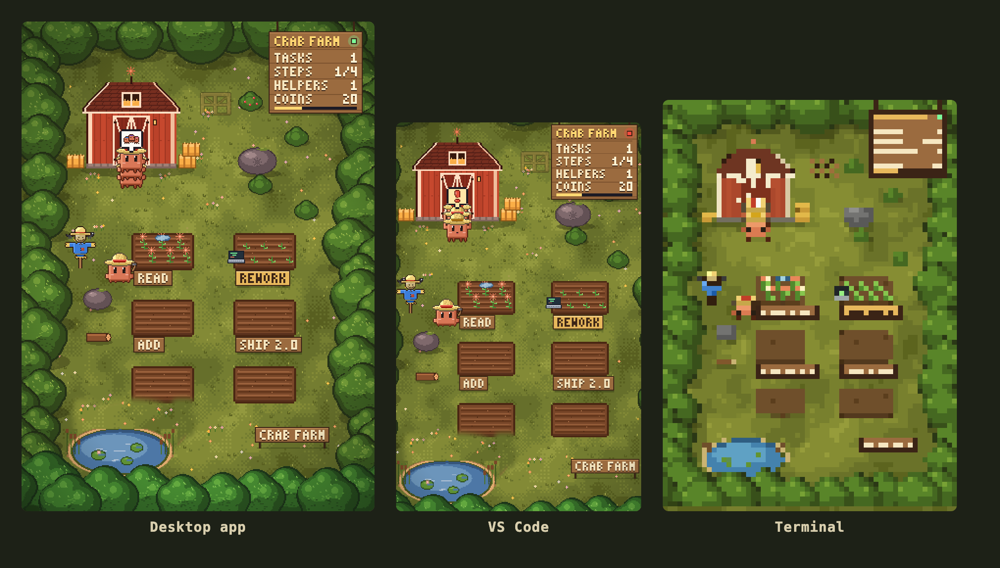

# Crab Farm

A living pixel farm that sits beside Claude Code and shows what Claude is doing, one crab per step.



Every step of Claude's plan gets its own named crab on its own plot. Every tool call is an errand you can watch: a Read is a slow walk along the crop row with a magnifier, an Edit is a hoe strike, a Bash command is a trip to the pond for water. Subagents are mini crabs in their model's colour. Finished work earns coins, and coins slowly build up the farm: a scarecrow in the first hour, a hen coop, a rain barrel, a mailbox, and on to a windmill and an orchard.

It is purely visual. It never calls a model, gives the model no tools, uses no network and costs no usage.

## What's new in 2.0

- **The crabs run errands.** Each tool call sends the working crab somewhere on the farm, and long commands hold it there until they finish.
- **Every crab has a name** (Pinchy, Clawdette, Sandy and four dozen more). The farmhand who minds the farm between tasks keeps its name across sessions.
- **Coins and builds.** Finished steps, tool calls and helpers earn coins. Twelve builds stand on the 2.0 farm; each one appears on its own when the farm can afford it.
- **A living farm.** The sky follows your clock and the season, the weather changes day to day, and between tasks the crabs tend the rows, wander and chat while the hens and the cat (once you have them) go about their day.
- **Everywhere.** The desktop app and VS Code draw the farm with hover cards. The terminal draws it in pixels. `/farm stats` tells it in words anywhere.
- **Your project and your model.** A wooden sign by the gate carries the project's folder name, and the working crab's hat band takes the colour of the model driving Claude.

## Install

**Claude Code in a terminal.** At the prompt:

```
/plugin install crab-farm --marketplace Adiezc/crab-farm
```

Answer `y` to add the marketplace, then pick a scope (user is the default). Or from a shell:

```bash
claude plugin install crab-farm --marketplace Adiezc/crab-farm
```

**The Claude desktop app.** Click **+** next to the prompt box, then **Plugins**, **Add marketplace** with `Adiezc/crab-farm`, then **Add plugin**.

**VS Code.** The Claude Code extension shares the CLI's plugins, so install it once from a terminal with the command above (or with `/plugin` inside Claude Code), then start a new Claude Code session in VS Code. The VS Code pane is new in 2.0: if your version of the extension shows no pane, `/farm stats` still tells you the farm, and the *Farm words in the spinner* option puts the crab's job in Claude's spinner.

The farm opens with each new session. In a terminal narrower than 144 columns, type `/farm` once to show it; after that it opens with each session from 110 columns. `/farm` hides it or brings it back.

## What you see

- **One crab per step.** The farm follows Claude's task list: the plan the desktop app shows, TodoWrite in the CLI and VS Code, or the Task tools. Up to six steps have plots at a time, and the step in progress always has one. A prompt with no list is one step, named after your prompt.
- **The signs** name each step; the gold one is the step in progress.
- **The bubble** over a crab says what it is doing: a terminal for a command, a scroll for reading, a quill for writing, a globe for the web, three dots while it thinks.
- **A red `!`** means a permission prompt or a question is waiting on you. Every crab stops where it stands until you answer, then carries on from the same spot. In auto mode, where Claude's classifier settles permissions, the farm shows no `!`.
- **A `?`** means the turn is over: your move.
- **Crops** grow as a step is worked on and ripen when it is done. The crab then picks the row and carries a crate to the yard, and the coins land with it.
- **Helpers.** Each subagent jogs out of the barn as a mini crab coloured by model (Haiku, Sonnet, Opus, Fable) and works the top of its step's plot. When it finishes it ferries its crates to the yard.
- **The board** shows tasks, steps done, helpers and coins, with a bar toward the next build. Its lamp is green while Claude works and red while it waits on you.
- **Hover** a plot, a helper, a build or the board in the desktop app or VS Code for a card with the details: the step, what the crab is doing and where, since when, how many calls.

### The jobs

| Claude uses | The crab |
|---|---|
| Read, git status or log, `cat` | walks the crop row with a magnifier |
| Grep, Glob, `ls`, `find` | looks over the fence |
| Edit | hoes the row |
| Write | fetches seed from the barn and sows |
| Bash (most commands) | fetches water: from the pond, then the rain barrel, then the well |
| tests (`npm test`, `pytest` …) | sets a sprinkler going for as long as the tests run |
| builds (`tsc`, `make` …) | turns the crank at the barn, later the windmill |
| installs (`npm install` …) | unloads sacks at the barn |
| `git commit` / `git push` | hammers a crate shut / sends it out at the gate |
| WebFetch | walks to the gate, later the mailbox |
| WebSearch | climbs the lookout rock |
| MCP tools | trades with a neighbour at the gate |
| the task list | hammers in its sign |
| a subagent | whistles at the barn door, and a helper comes out |

### The builds

Coins are counted for life and never spent: each build appears the moment the farm's lifetime coins reach it.

| Build | Lifetime coins | Build | Lifetime coins |
|---|---|---|---|
| Scarecrow | 10 | Cat | 450 |
| Hen coop | 40 | Flower border | 660 |
| Rain barrel | 90 | Beehive | 930 |
| Mailbox | 170 | Well with pump | 1,270 |
| Bench | 290 | Fishing jetty | 1,690 |
| Windmill | 2,190 | Orchard | 2,790 |

The next build stands as a ghost scaffold that fills in as coins come. Twelve more builds (a cow, a market stall, ducks, a greenhouse and others) arrive in 2.1; coins earned past the twelfth keep counting toward them.

**Coins come from:** 10 for each finished step that saw work (5 after 60 in a day), 1 for each of Claude's tool calls (the first 100 a day, then 1 for every 4), 2 for each helper that finishes, and a dawn basket with the first prompt of each day (bigger once there are hens and bees). Coming from 1.2, each old harvest is worth 10 coins (up to 2,190), so a 1.2 farm starts with its first builds already standing.

## Commands

- `/farm` shows or hides the farm for this session.
- `/farm stats` answers in a few lines: coins, the next build and how far along it is, builds owned, harvests, crates, days farmed, steps done this session, and what each crab is doing. It works everywhere, pane or not.

## Options

Each is a row in `/config`.

| Option | Default | What it does |
|---|---|---|
| Farm motion | `full` | `calm`: no walking about between jobs and no particles. `still`: a still picture that changes as the work does. |
| Seasons | `auto` | follows your time zone's hemisphere; `north` or `south` sets it. |
| Hover details | on | the cards on hover in the desktop app and VS Code. |
| Terminal farm | `pixels` | `text` keeps 1.2's list of steps instead of the picture. |
| Farm words in the spinner | off | Claude's spinner says the crab's job (Watering, Tilling) instead of its own word. |

The pictures also honour your system's reduced-motion setting where the window passes it on.

## The no-guilt rules

- Nothing withers, dies, runs away or is taken. A stopped turn makes the crops droop; they recover on the next call.
- No streaks: only lifetime counts, like days farmed.
- Time away costs nothing.
- No timers to come back for, no toasts, no sounds, no notifications.
- The board's coins only move when a crate lands or a build appears, never per tool call.
- Working late gets a lantern, not a remark.
- Nothing needs a click or a hover to be understood.

## The promise

Crab Farm only watches what Claude already does and draws it. It never calls a model, adds no tools for the model, makes no network requests and uses none of your usage. It keeps its coins in Claude Code's own plugin storage on your machine, one farm per user, shared by every project.

## Light by design

- The farm is written only when the picture would change, at most twice per tool call. A subagent's own tool calls don't redraw anything.
- Movement between redraws is CSS on the clock, so an idle farm redraws about twenty times an hour.
- In the terminal, frames are sent only when a pixel changed, and not at all while the pane is hidden.

## Develop

```bash
scripts/check.sh            # validate --strict, the tests, the purity and promise checks, the art build check
claude --plugin-dir .
```

The wiring is [hooks/register.tsx](hooks/register.tsx); the farm's rules live in [hooks/model](hooks/model), the drawing in [hooks/render](hooks/render), and the art is generated into [hooks/art.ts](hooks/art.ts) by [scripts/build_art.py](scripts/build_art.py).

## Credits

The farm art (meadow, trees, barn, pond, plots, critters, helpers, laptops, crops and bubble icons) comes from [clodfarm](https://github.com/matank001/clodfarm) by matank001 / Duke Security, used under its MIT licence. Go and look at it: Crab Farm is a small fan-made side pane built on its look. Details in [CREDITS.md](CREDITS.md).

## License

[MIT](LICENSE) © 2026 Adrian Diez Cuadrado
