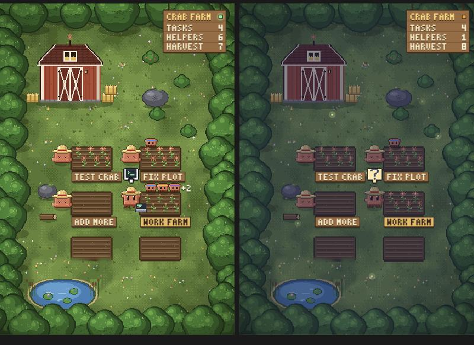

# Crab Farm

A tiny pixel farm that lives in a side pane of Claude Code and keeps you company while Claude works.



Every task you give Claude gets its own little crab-Claude on its own plot. Subagents it spawns show up as small helpers on that plot. Crops grow while Claude works, bloom when it's waiting for you, and the farm follows your clock from dawn to night (with fireflies).

It's purely visual. It never calls a model and adds no tools, so it costs no usage.

## Install

At the prompt of a Claude Code terminal session:

```
/plugin install crab-farm --marketplace Adiezc/crab-farm
```

Answer `y` to add the marketplace, then pick a scope (user is the default). The farm opens in a pane straight away.

From a shell instead:

```bash
claude plugin install crab-farm --marketplace Adiezc/crab-farm
```

In the Claude desktop app: click **+** next to the prompt box, then **Plugins**, **Add marketplace** with `Adiezc/crab-farm`, then **Add plugin**.

## Use

- The pane opens with each session. `/farm` hides it or brings it back.
- **A new task, a new Claude.** In the desktop app, a request Claude treats as a new task plants a new plot; follow-ups stay with the current one. Elsewhere, the session's first prompt gets the Claude.
- **Helpers.** Each running subagent stands on the plot of the task that spawned it, coloured by model (Haiku, Sonnet, Opus, Fable). Up to three show, then `+N`.
- **States.** Typing at a laptop: working. A `?` bubble: waiting for you. Dozing by ripe crops: a finished task.
- **The board** counts tasks, helpers and your harvest (kept across sessions). Its lamp is green while Claude works.
- In a plain terminal, where panes can't draw pictures, the same farm shows as a few lines of text.

## Light by design

- No model calls, no tools for the model, no network.
- State is written only when the picture would change. A subagent's tool calls don't redraw anything.
- Only the busy Claude animates; finished ones are still images. Animations stop under reduced motion.

## Develop

```bash
claude plugin validate .
claude plugin test .
claude --plugin-dir .
```

The farm is drawn in [hooks/register.tsx](hooks/register.tsx); the sprites live in [hooks/art.ts](hooks/art.ts).

## Credits

The farm art (meadow, trees, barn, pond, plots, critters, helpers, laptops, crops and bubble icons) comes from [clodfarm](https://github.com/matank001/clodfarm) by matank001 / Duke Security, used under its MIT licence. Go and look at it: Crab Farm is a small fan-made side pane built on its look. Details in [CREDITS.md](CREDITS.md).

## License

[MIT](LICENSE) © 2026 Adrian Diez Cuadrado
